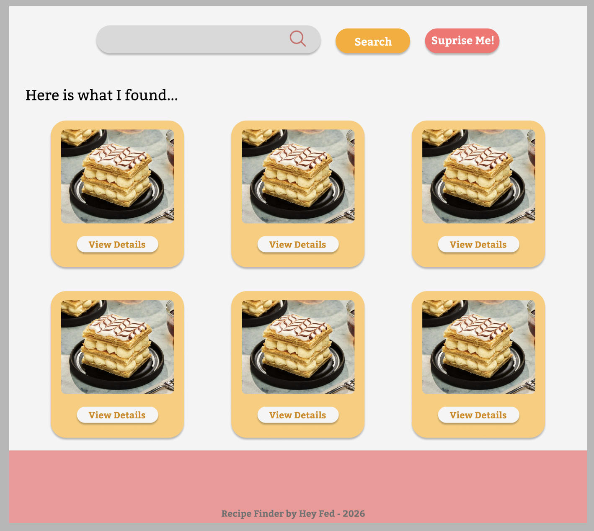
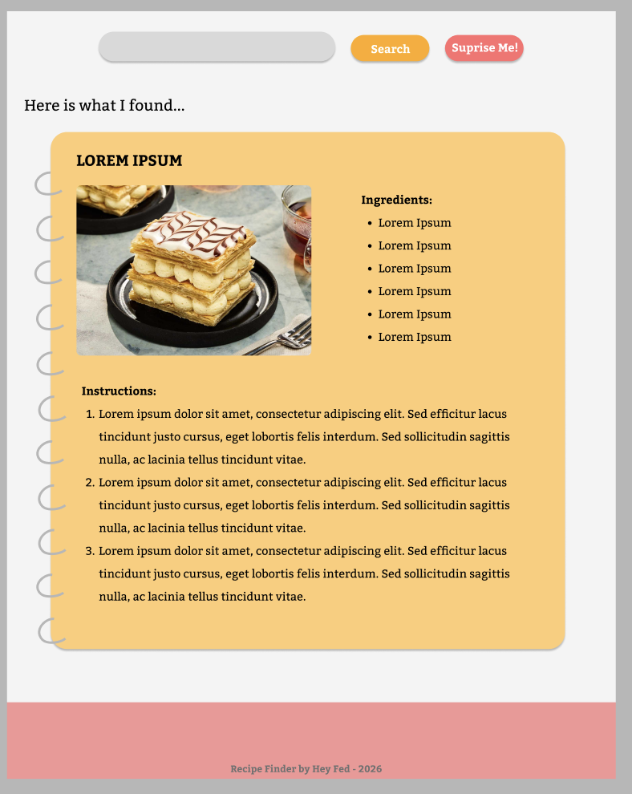

# Recipe Finder - Plannning 
## What data will you fetch from the API? 📊
This will be a dynamic recipe finder that is going to allow the users to search meals by specifying ingredients and view the detail instructions with an image of the dish also if the user doesn’t know what to prepare it will have an option to select a random recipe. 

## Which API endpoints will you use? 👩🏻‍💻
**Search:** 'themealdb.com/api/json/v1/1/filter.php?i=chicken_breast' 
- This one will be useful to match recipes based on user's ingredient input 

**Intructions**: 'themealdb.com/api/json/v1/1/lookup.php?i=52772'
- this is to specify the cooking instruction and the list of ingredients a single selected recipe 

**Random recipe**: 'themealdb.com/api/json/v1/1/random.php'
- for the ramdom selection of the user 

## How will the user interact with your page?
- The user types the ingredient that they have into the text input and clicks "search"
- The page shows the recipe cards with a image and title 
- The user clicks "view details" on the recipe card that they are interested to see the intructions and ingredients. 

## Wireframe

 